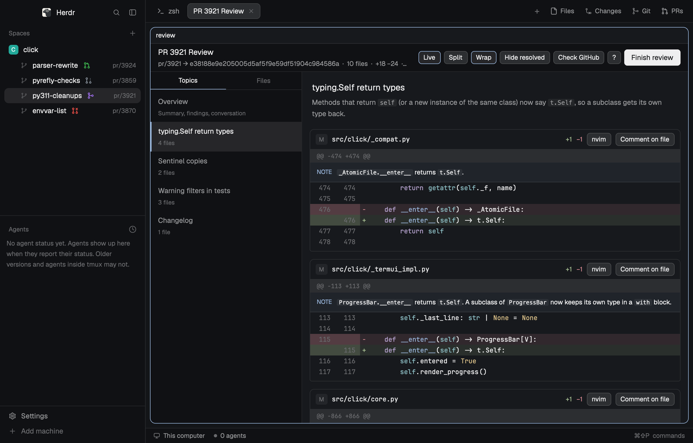

# Review for Herdr

A code review of a branch or a PR in its own [Herdr](https://herdr.dev) tab, CodeRabbit style: topics, a note on
every hunk, findings as line threads, GitHub-like comments and suggestions. Finish the review to send the comments
to a Claude Code session (it changes the code and answers in the threads) or to post them to GitHub as one PR
review. Live diff, syntax colors, ty hover cards, open any line in Neovim.



## Install

Ask your Herdr agent: *"add the mod at github.com/dadodimauro/herdr-review"*. Or by hand:

```sh
git clone https://github.com/dadodimauro/herdr-review
cp -R herdr-review/mods/review ~/.config/herdr-app/mods/
cp -R herdr-review/skill/herdr-review ~/.claude/skills/
herdr-app check ~/.config/herdr-app/mods/review
```

Then, in Claude Code inside a Herdr terminal, in a repo: `/herdr-review` (your branch) or `/herdr-review 123` (a
PR). Needs `uv`, `git`, `gh` (logged in) and `hc`; optional `ty` (`uv tool install ty`), `nvim` and `mmdc`
(`npm install -g @mermaid-js/mermaid-cli`).

[RECIPE.md](RECIPE.md) is the full brief to build it from an empty folder.

## License

[WTFPL](LICENSE).
