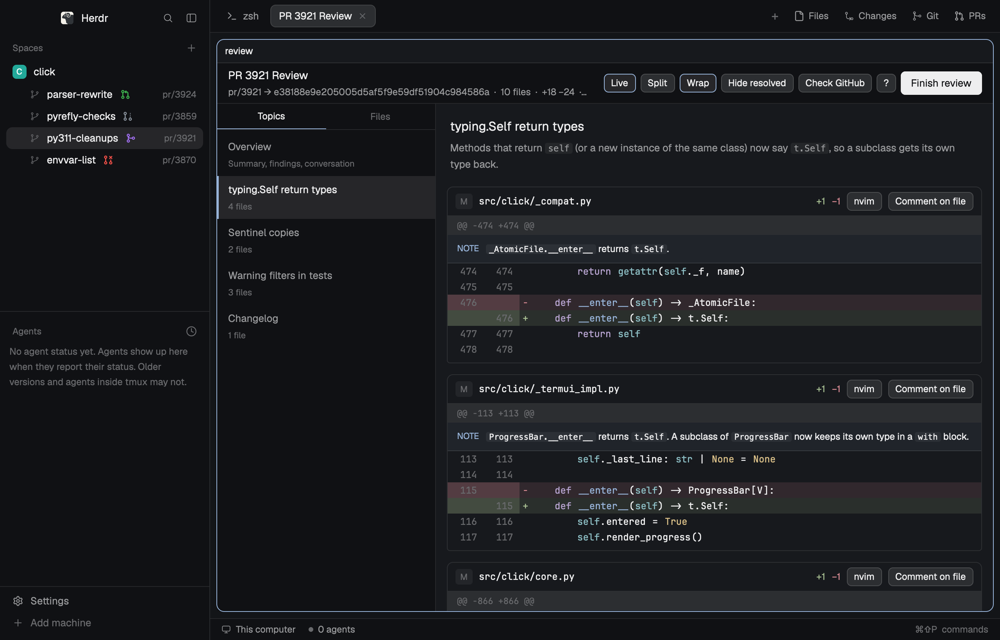

# Review

A code review of a branch or a pull request in its own Herdr tab, CodeRabbit style: the change in topics, a note on
every hunk, Claude's findings as threads on their lines, and GitHub-like comments, replies, suggestions and
resolve. When you finish, the comments go to a Claude Code session (which changes the code and answers in the
threads) or to GitHub as one PR review. The diff follows your edits live, has syntax colors and ty hover cards, and
opens any line in Neovim.



It has two parts, both in this folder: the mod (`mods/review/`) draws the review, and the Claude Code skill
(`skill/herdr-review/`) builds it and acts on the comments. Install the skill as `~/.claude/skills/herdr-review/`.

## What you see

One tab, a column on `background`, base text 13px. Top to bottom:

- **Header**, 52px, `chrome`, 14px side padding, bottom border. Left: the title (14px semibold, else the heading)
  and a `muted` 12px line `branch → base · N files · +adds −dels · PR #n · uncommitted work · live hh:mm:ss · N
  hunks changed after the review · LSP…` (parts only when they apply, errors of the helpers in place of a part).
  Right, 24px buttons (12px, padding 8, radius 6, 1px border; `selected` with an `accent` border when on): **Live**,
  **Split**, **Wrap**, **Hide resolved**, **Check GitHub** (only with a PR), **?**, then **Finish review (N drafts)**
  (30px, `solid`).
- **Sidebar**, 280px, right border: two tabs **Topics** and **Files**. First row **Overview** ("Summary, findings,
  conversation"). Then one row per topic (title, "N files") or per file (`M  name`, `dir · +a −d`), with a count
  of open threads; the chosen row `selected` with a 2px `accent` left edge.
- **Overview**: the heading and intro (HTML), a PR box (state, review decision, reviewers with their state, checks
  grouped by result with the failing names, when GitHub was read), the topics, Claude's findings (severity chip:
  Critical `ansi1`, Major `ansi3`, Minor `ansi4`, Nit `dim`), the Mermaid diagram (rendered to PNG with `mmdc`,
  dark or light, else its source), the PR conversation, general comments with **Add a general comment**, and the
  batches you sent ("Send again" for a Claude batch still pending).
- **Topic or file**: the topic's title and summary, then one card per file: a header (status letter, path,
  `+a −d`, **nvim**, **Comment on file**), and per hunk a `@@ -old +new @@` bar, a **NOTE** row (`accent` at 7%)
  with the hunk's note, then the lines. Unified: two 46px line-number columns, a sign, the code in the terminal
  font, 20px rows; added lines `ansi2` at 13%, removed `ansi1` at 13%, their numbers a little stronger. **Split**:
  old left, new right. Line notes sit under their line. A hunk that changed after the review gets a chip "changed
  after the review · no note".
- **Threads** under their line (or at the file, or in Overview): author (You / Claude / a GitHub login), time,
  Markdown body, a suggestion block as a diff, finding chips; buttons **Reply**, **Resolve** / **Reopen**, **Open in
  nvim**, and **Edit** / **Delete** on your own drafts. A GitHub thread whose line is gone shows "line changed" at its
  file, like GitHub's "Outdated".
- **Composer**: a textarea, ⌘↵ saves as a draft, Esc cancels, **Suggest change** puts the selected lines in a
  ```suggestion block.
- **Selection bar** after you click a line number: "Lines N–M" with **Comment** (`c`), **Open in nvim** (`o`) and
  **✕**.
- **Dialogs** over the tab: the key list (`?`), the Check GitHub result (changes since the build; "Ask Claude to
  rebuild" when the code is new), and **Finish review**.

## How it behaves

- Agent statuses (working, blocked, done, idle) are not shown: the review talks to one Claude session by name.
- **Open**: `herdr-app do tab.new '{"name": "<title>", "mod": "review", "props": {"folder": "<review folder>"}}'`.
  Props: `folder` (required), `view` (`{kind: "topic", id}` or `{kind: "file", path}`), `split`.
- **Data**: `review.json` (the page data: files, hunks, notes, syntax, LSP tokens, GitHub), `notes.json`,
  `herdr.json` (`skill`, `session`), and the documents in `db/comments/`, `db/batches/`, `db/ghthreads/` (one JSON
  file each, read in one `sh` call that prints a marker line before each file). The mod watches `db/`: a change of
  `db/meta.json` reloads the review, any other file reloads the documents. Writes use `writeTextFile` with the
  previous text as `expected` (compare and swap), and retry once.
- **Comment**: click a line number to select it, shift-click for a range, then **Comment**. A comment stores its
  anchor (`path`, `side`, `line`, `startLine`), the line's text and a few lines of snippet. On a new build a thread
  finds its line again by that text (nearest match); when the text is gone, it shows at its file.
- **Live** (on by default): a change in the checkout (not `.git`, `node_modules`, caches, `.pyc`, editor swap files)
  waits 400 ms, then the mod runs the skill's `live.py`: the diff becomes the working tree, unchanged hunks keep
  their notes. After each load and live update it runs `lsp_tokens.py`: hover text, definitions and uses from `ty`.
  ⌘-click a name with a definition in the repo to open it in Neovim.
- **Open in Neovim** (`o`, **Open in nvim**, double-click a line): the tab's Neovim on the socket
  `/tmp/herdr-nvim-<tab id>.sock`. Alive (`nvim --server <sock> --remote-expr 1`): `--remote-send` an `:edit +N`
  of the file, then focus its terminal. Else `terminal.open {argv: ["nvim", "--listen", <sock>, "+N", <file>],
  place: "right"}`.
- **Check GitHub** (`g`): runs `github_refresh.py`: the PR's threads, conversation, reviewers and checks again,
  without Claude.
- **Finish review**: choose **Claude** or **GitHub**.
  - Claude: pick a session (Herdr's agents that run Claude Code; the one in `herdr.json` first). The mod writes a
    batch (`db/batches/<id>.json`, status `pending`), marks the drafts `to_claude`, closes the dialog, and in the
    background runs `hc send <session> "/herdr-review batch <folder> <id>"` with a 10 s timeout (`hc send` waits
    while that session's input has a draft). On a timeout the batch stays pending, with **Send again** in Overview.
    The skill answers in the threads; the files show up live.
  - GitHub (with a PR): choose Comment, Approve or Request changes, write the summary, pick drafts, Claude's
    findings and GitHub threads to resolve or reopen. **Plan** runs `github.py plan` (reads only) and shows where
    each item goes. **Post** runs `github.py post` and writes back `posted` with the GitHub URL, or the item becomes
    a draft again with the reason. Close always works.
- **Keys** (when the tab has the keyboard): `j`/`k` hunks, `n`/`p` files, `]`/`[` open threads, `N`/`P` topics, `s`
  split, `w` wrap, `c` comment, `o` Neovim, `g` Check GitHub, `f` finish, `?` keys, Esc closes.

## Built from

- `mods/review/`, `mod.json` `{ "place": "none", "title": "review", "focusable": true }`:
  - `main.js`: the `Review` view: data, navigation, threads, header, sidebar, Overview, dialogs, keys
    (`nextCommand()` "focus" focuses its key handle).
  - `diff.js`: hunk rows, split pairs, the code cell (syntax spans and LSP tokens, wrap at spaces), gutters, token
    tooltips.
  - `data.js`: `readJson`, `loadDocs`, `writeDoc`, `newId`, `runSkill` (runs `uv run --no-project --with pygments
    python <skill>/<script>` in the review's checkout).
  - `send.js`: batches, `hc send`, the GitHub plan and post.
  - `nvim.js`: `openInNvim(file, root, line)`.
- Rows are a plain (not virtual) scroll list: rows need click handlers, and `ScrollHandle.scroll_to_item` reveals
  direct children only, so the list keeps navigation metadata per child.
- `skill/herdr-review/` (Claude Code skill): `SKILL.md` (Build, Rebuild, Act on a batch), `extract.py`
  (`review.json` without file blobs, `db/`, `herdr.json`), `live.py`, `lsp_tokens.py`, `github_refresh.py`, and
  `lib/` with the review builder: `lib/code-review-diff/build.py` (`skeleton`, `page`, notes validation, carry-over
  of notes, syntax with Pygments, GitHub data), `github.py` (`plan`, `post`), `template.html`, and
  `lib/create-diff/build.py` + `lsp.py` (diff parsing, the `ty server` client).
- Programs: `uv` (Python 3.10+, Pygments on demand), `git`, `gh` (logged in), `hc`, `nvim`; optional `ty`
  (`uv tool install ty`) and `mmdc` (`npm install -g @mermaid-js/mermaid-cli`; `sips` reads the PNG size on macOS).
- Commands: `tab.new`, `terminal.open`, `pane.focus`. The dialogs are drawn inside the tab, not as overlays.

## Watch out

- `readTextFile` reads at most 1 MiB: `review.json` drops the file blobs and keeps syntax and tokens for the diff
  lines only (both sides of context lines, for the split view); read a bigger file with `exec("cat")`.
- Herdr reloads a mod when a non-hidden file in its folder changes: keep caches (the diagram PNGs) in `.cache/`.
- `line_height(n)` takes a multiplier: give rows `"20px"`.
- Pass `click_count` from the event for double-clicks; a code area's `on_click` with `click_count >= 2` opens
  Neovim, a single click with ⌘ on a token opens its definition.
- `hc send` blocks while the target input has an unsent draft: always give it a timeout, save the batch first, and
  never leave a dialog that cannot close.
- Two tabs on one review can run the helpers at the same time: they take a lock on `<folder>/.herdr.lock` and write
  with a temp file and rename.
- `exec` drops control characters such as `\x1e`: use printable markers to split one output into files.
- A composer textarea must stop `mouse_down` propagation, or the click selects a line under it.

## Done when

- `herdr-app check ~/.config/herdr-app/mods/review` passes.
- `/herdr-review` in Claude Code, in a repo with a branch, opens a tab with topics, notes on every hunk and
  syntax colors; with `ty`, hovering a name shows its type.
- A comment on a line, sent with Finish review → Claude, gets a reply from Claude in the same thread, and the thread
  is resolved when the change answers it.
- Editing a file in Neovim updates the diff within a second or two; the changed hunk shows "changed after the
  review".
- Double-click on a line opens it in the tab's Neovim at that line; a second double-click reuses it.
- For a PR, Check GitHub shows the PR's threads on their lines and the PR box; Finish review → GitHub shows the
  plan and posts only after **Post**.
